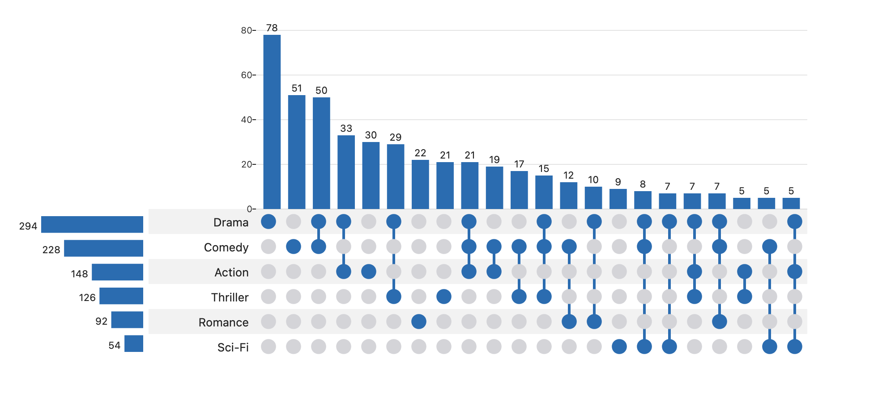

# layerchart-upset

An [UpSet plot](https://upset.app/) Svelte 5 component built on [LayerChart](https://www.layerchart.com/),
with an API modelled on R's [ComplexUpset](https://krassowski.github.io/complex-upset/).



```svelte
<script>
  import { UpSet } from 'layerchart-upset';
  // one row per item, one boolean column per set
  const data = [{ A: true, B: false, C: true }, /* ... */];
</script>

<UpSet {data} sets={['A', 'B', 'C']} minSize={2} bind:selected />
```

## Precomputed counts

Already have the counts? Skip the per-item rows:

```svelte
<UpSet
  sets={['treated vs control', 'KO vs WT']}
  intersections={[
    { id: 'a', sets: ['treated vs control'], size: 42 },
    { id: 'c', sets: ['treated vs control', 'KO vs WT'], size: 9 }
  ]}
  emphasizedSets={['KO vs WT']}
  minSlots={8}
  bind:selected
/>
```

Order is kept as given (sort with `sortIntersectionsBy`). Add `setSizes` to show the set-size panel.

## Accessibility and test hooks

Each bar is a `role="button"` with `aria-label`, `aria-pressed`, and is a Tab stop. Enter/Space select,
←/→/Home/End move focus, Esc clears. Hooks: `data-upset-bar` (+ `data-id`, `data-n`, `data-tip`),
`data-upset-count`, `data-upset-row`, `data-upset-set-bar`. Extra attributes on `<UpSet>` go to the root.

## Props

| prop | default | |
|---|---|---|
| `data`, `sets` | – | rows with boolean membership columns, and the column names |
| `mode` | `'distinct'` | `distinct` (exclusive), `intersect` (inclusive), `union` |
| `sortIntersectionsBy` / `Order` | `cardinality` / `descending` | or `degree`, `none` |
| `sortSetsBy` / `Order` | `cardinality` / `descending` | |
| `minSize` `maxSize` `minDegree` `maxDegree` `limit` | – | filter intersections |
| `cellSize` `barHeight` `setBarWidth` `labelWidth` | 28 200 150 120 | layout, px |
| `color` | `#2b6cb0` | string, or `(intersection) => string` to color each column |
| `setColors`, `highlightColor` | – | per-set colors; color of the selected column |
| `inactiveColor` `dimOpacity` | | inactive dots; opacity of non-focused columns (1 disables dimming) |
| `dotRadius` `connectorWidth` `barPadding` `barRadius` `fontSize` | .3 3 .3 2 12 | geometry / typography |
| `intersectionLabel` `setLabel` | – | axis titles |
| `showLabels` `stripes` `tooltips` | true | toggles |
| `selected` (bindable), `onselect` | | click / Enter / Space selects an intersection |
| `intersections` `setSizes` `total` | – | precomputed input (see above) |
| `tooltip` (snippet), `describe`, `tooltips`, `onhover` | | tooltip content / events |
| `setLabels` `emphasizedSets` `emphasisMarker` `maxLabelLength` | | row labels |
| `showSetSizes` `minSlots` `yTicks` `formatSize` | | layout / axis |

`computeUpset(data, sets, options)` is exported for use without the component.

Run `npm run dev` for the demo page.

## Development

`npm run check`, `npm test` and `npm run build` run in CI on every push and PR.
